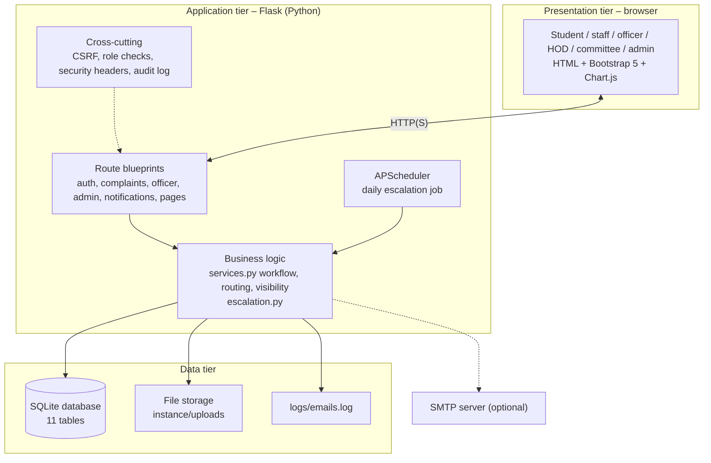
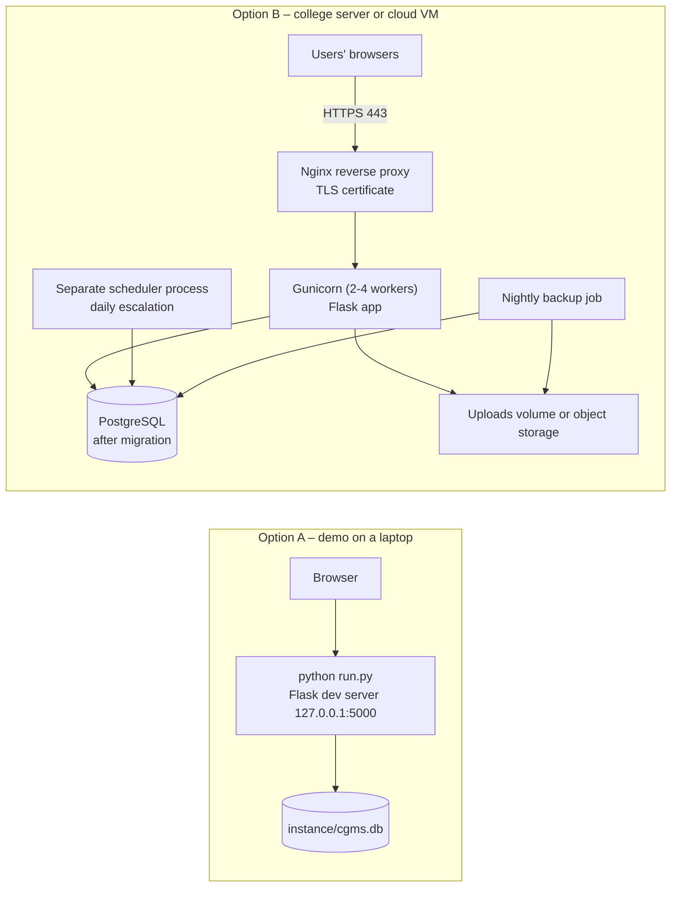
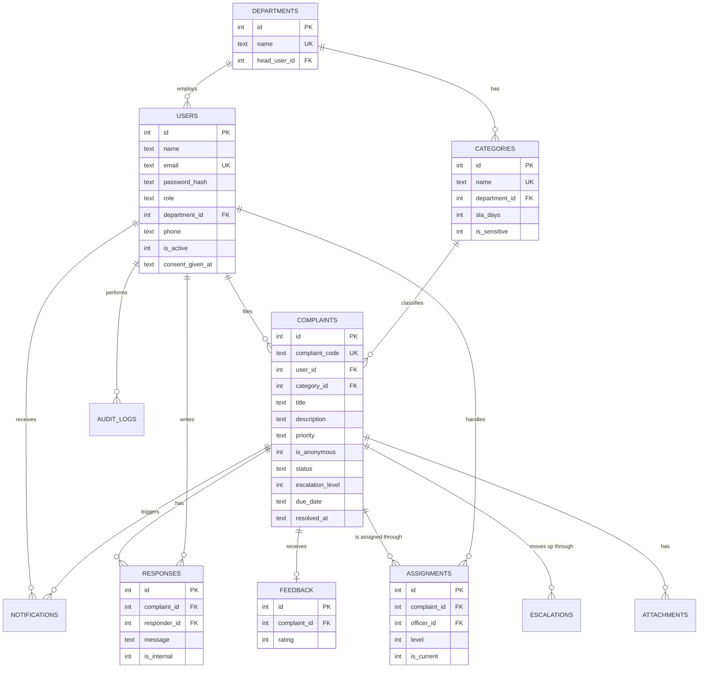
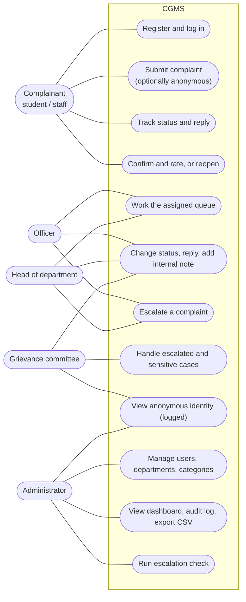

# Architecture, deployment, ER and use cases

## 1. Architecture diagram (three-tier)

*Figure 9 – System architecture.*

### Technology choices
| Choice | Reason |
|---|---|
| Python + Flask | Small, readable, well documented; easy for every team member to explain |
| SQLite | Zero setup, one file, enough for a single college's complaint volume; same SQL moves to PostgreSQL |
| Jinja2 templates + Bootstrap 5 | Server-rendered pages are simple, accessible and work without a JavaScript framework |
| Flask-WTF (CSRF) | Standard protection against cross-site request forgery |
| Werkzeug hashing (PBKDF2-SHA256) | Safe password storage using a maintained library |
| APScheduler | Daily job without installing Celery or Redis |
| Chart.js | Lightweight charts for the dashboard |
| pytest | Simple automated tests with a temporary database |

## 2. Deployment diagram

*Figure 10 – Deployment options.*

Production notes: set `SECRET_KEY` and `COOKIE_SECURE=1`, leave `FLASK_DEBUG` unset, serve only over HTTPS, run the scheduler as one process only, and back up the database and uploads nightly.

## 3. Scalability
| Bottleneck | Why it matters | How to scale |
|---|---|---|
| SQLite allows one writer at a time | Many users submitting together would queue | Move to PostgreSQL (change the connection layer; SQL is standard) |
| Single Flask process | Limited concurrency | Gunicorn with several workers behind Nginx |
| Scheduler inside the app process | With several workers the job could run more than once | Run it as its own process, or use Celery beat / cron calling an endpoint |
| Uploads on local disk | Not shared between servers | Object storage (for example S3 compatible) |
| In-memory login lockout | Lost on restart and not shared between workers | Store attempts in Redis or the database |
| E-mail sent inside the request | Slow SMTP delays the user | Queue e-mails with Celery or RQ |

For about 5,000 users, indexes on status, user, due date and assignments keep queries fast, and pagination limits the rows returned.

## 4. Entity–relationship diagram

*Figure 11 – ER diagram (main attributes).*

## 5. Use case diagram

*Figure 12 – Use case diagram.*
