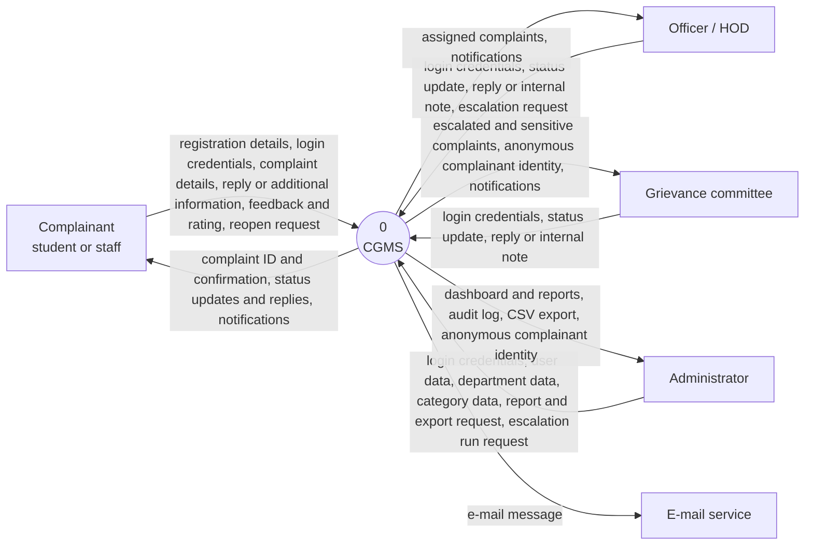
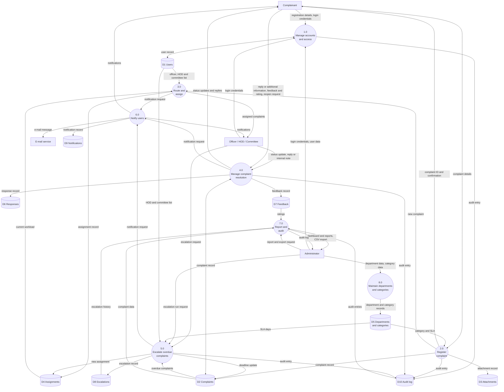
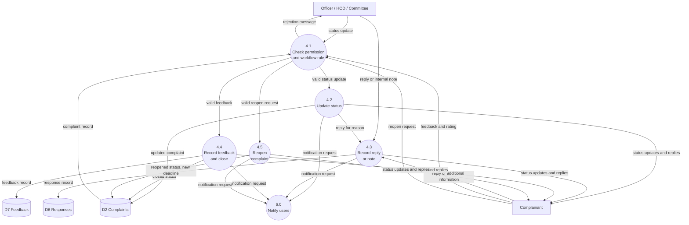

# Data Flow Diagrams (Gane & Sarson style notation expressed in Mermaid)

Notation: rectangles = external entities, circles = processes, cylinders = data stores, arrows = data flows.

## Level 0 – Context diagram

*Figure 2 – DFD Level 0.*

## Level 1 – Major processes

*Figure 3 – DFD Level 1.*

## Level 2 – Process 4.0 Manage complaint resolution

*Figure 4 – DFD Level 2 for process 4.0.*

### Balancing check (Level 1 ⇄ Level 2 for process 4.0)
| Flow at the boundary of 4.0 in Level 1 | Appears in Level 2 as |
|---|---|
| IN: status update (Officer) | into 4.1 |
| IN: reply or internal note (Officer) | into 4.3 |
| IN: reply or additional information (Complainant) | into 4.3 |
| IN: feedback and rating (Complainant) | into 4.1 |
| IN: reopen request (Complainant) | into 4.1 |
| IN: complaint record (from D2) | into 4.1 |
| OUT: status updates and replies (to Complainant) | out of 4.2, 4.3, 4.4, 4.5 |
| OUT: notification request (to 6.0) | out of 4.2, 4.3, 4.4, 4.5 |
| OUT: complaint record (to D2) | out of 4.2, 4.4, 4.5 |
| OUT: response record (to D6) | out of 4.3 |
| OUT: feedback record (to D7) | out of 4.4 |
| OUT: audit entry (to D10) | recorded by every sub-process |

Level 0 ⇄ Level 1 balancing: every Level 0 flow appears at Level 1 – registration/login/user data into 1.0; complaint details into 2.0; replies, feedback and reopen into 4.0; status update and internal note into 4.0; escalation request and run request into 5.0; report and export request into 7.0; department and category data into 8.0; notifications and e-mail out of 6.0; reports and audit log out of 7.0. No flow was added or dropped.

---

# Data dictionary

## Data flows
| Data flow | Composition | Source → Destination |
|---|---|---|
| Registration details | name + email + role + department + [phone] + password + consent | Complainant → 1.0 |
| Login credentials | email + password | Any user → 1.0 |
| User data | name + email + role + [department] + temporary password + active flag | Administrator → 1.0 |
| Complaint details | category + title + description + priority + [anonymous flag] + [attachment]* | Complainant → 2.0 |
| Complaint ID and confirmation | complaint code + status + due date | 2.0 → Complainant |
| Status update | new status + [message] | Officer/Committee → 4.0 |
| Reply or internal note | message + internal flag | Officer → 4.0 |
| Reply or additional information | message | Complainant → 4.0 |
| Feedback and rating | rating (1–5) + [comments] | Complainant → 4.0 |
| Reopen request | reason message | Complainant → 4.0 |
| Status updates and replies | status + message + timestamp | 4.0 → Complainant |
| Escalation request | reason | Officer → 5.0 |
| Escalation run request | (button press) | Administrator → 5.0 |
| Notification request | recipient + message + complaint reference | 3.0, 4.0, 5.0 → 6.0 |
| Notifications | message + time + read flag | 6.0 → users |
| E-mail message | recipient address + subject + body | 6.0 → E-mail service |
| Department data / Category data | name + [head] / name + department + SLA days + sensitivity | Administrator → 8.0 |
| Report and export request | filters | Administrator → 7.0 |
| Dashboard and reports, CSV export | counts + averages + chart data / rows | 7.0 → Administrator |
| Audit entry / Audit log | user + action + item + details + IP + time | processes → D10 → 7.0 |
| Anonymous complainant identity | name + e-mail + phone | 7.0/4.0 → Committee, Administrator (logged) |

`[ ]` optional, `*` repeated (maximum 3 per upload, 5 per complaint).

## Data stores
| Store | Database table | Contents |
|---|---|---|
| D1 Users | `users` | Accounts, roles, hashed passwords, consent time |
| D2 Complaints | `complaints` | Complaint record, status, level, deadlines |
| D3 Attachments | `attachments` + files in `instance/uploads` | Evidence files |
| D4 Assignments | `assignments` | Who handles a complaint at each level |
| D5 Departments and categories | `departments`, `categories` | Reference data and SLA days |
| D6 Responses | `responses` | Public replies and internal notes |
| D7 Feedback | `feedback` | One rating per complaint |
| D8 Escalations | `escalations` | History of level changes |
| D9 Notifications | `notifications` | In-app messages |
| D10 Audit log | `audit_logs` | Record of important actions |

## Key data elements
| Element | Type / length | Format or domain | Description |
|---|---|---|---|
| user.id, complaint.id | integer | auto-increment | Internal keys |
| complaint_code | text, 15 | `CGMS-YYYY-NNNNN` | Public complaint ID |
| email | text, ≤120 | valid address, unique | Login name |
| password_hash | text | PBKDF2-SHA256 | Never the plain password |
| role | text | student, staff, officer, hod, committee, admin | Access level |
| title | text, 5–150 | | Short summary |
| description | text, 20–5000 | | Full complaint |
| priority | text | Low, Medium, High, Critical | Urgency |
| is_anonymous | integer | 0 or 1 | Hide identity from officers |
| status | text | Submitted, Under Review, In Progress, Awaiting Info, Resolved, Closed, Rejected, Reopened | Workflow state |
| escalation_level | integer | 1, 2, 3 | Officer, HOD, Committee |
| due_date, created_at, resolved_at | text | `YYYY-MM-DD HH:MM:SS` local time | Timestamps |
| sla_days | integer | 1–90 | Days allowed to resolve |
| is_sensitive | integer | 0 or 1 | Route straight to the committee |
| stored_name | text | UUID + extension | Name of a file on disk |
| rating | integer | 1–5 | Satisfaction score |
| is_internal | integer | 0 or 1 | Note hidden from the complainant |
