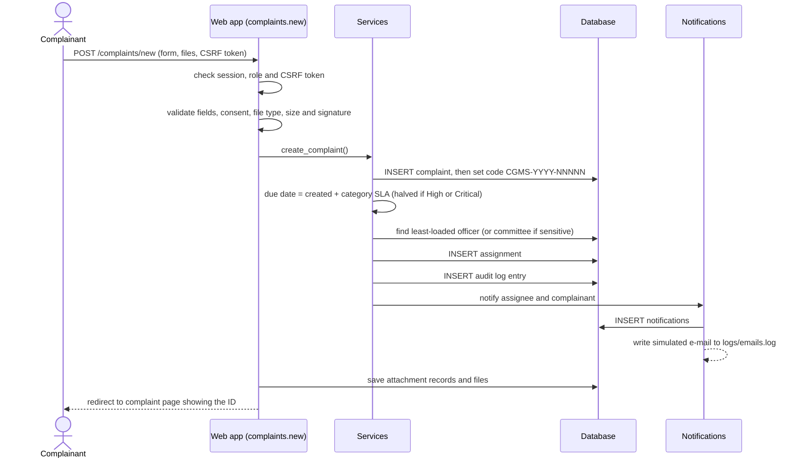
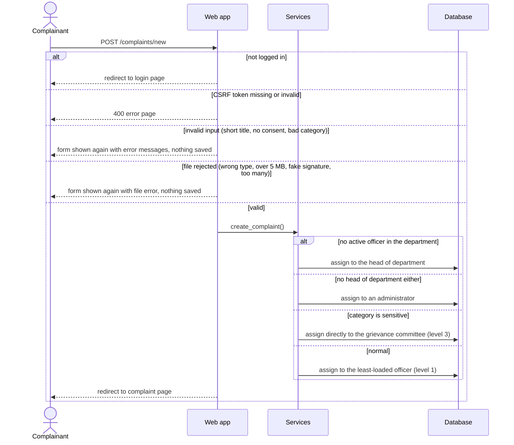
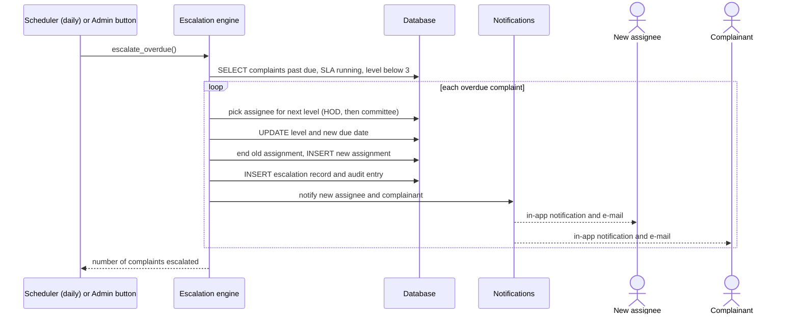
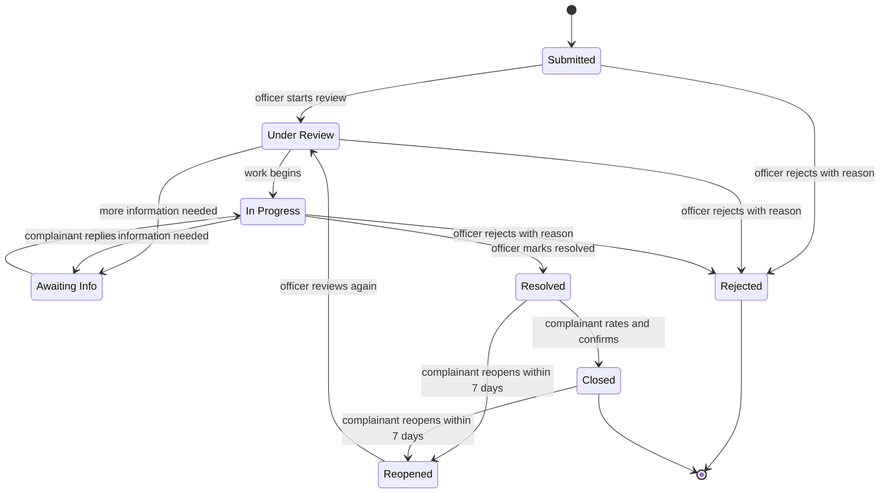

# Sequence diagrams and state diagram

## 1. Submit complaint – normal flow

*Figure 5 – Submit complaint (normal flow).*

## 2. Submit complaint – alternate and error flows

*Figure 6 – Submit complaint (alternate flows).*

## 3. Escalation of an overdue complaint

*Figure 7 – Escalation flow.*

## 4. Complaint status state diagram

*Figure 8 – Status workflow.*

| Transition | Who may trigger it | Rule |
|---|---|---|
| Submitted → Under Review | Assigned officer, HOD, committee, admin | – |
| Any open state → Rejected | Staff roles | A reason is mandatory and is shown to the complainant |
| Under Review / In Progress → Awaiting Info | Staff roles | A message is mandatory; the SLA clock pauses |
| Awaiting Info → In Progress | Complainant (by replying) or staff | Automatic on the complainant's reply |
| In Progress → Resolved | Staff roles | Records `resolved_at` |
| Resolved → Closed | Complainant only | Done by giving a rating, only once |
| Resolved / Closed → Reopened | Complainant only | Reason mandatory; within 7 days of resolution; new deadline |
| Reopened → Under Review | Staff roles | – |
| Any other change | Admin only | Recorded as `status_override` in the audit log |
