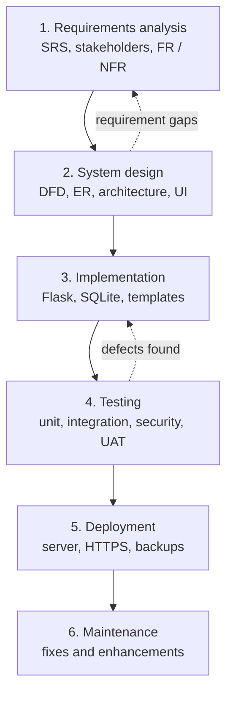

# Process model – Waterfall

*Figure 1 – Waterfall model with limited feedback loops.*

## Phases applied to this project
| Phase | Work done | Deliverable |
|---|---|---|
| Requirements | Problem statement, stakeholders, functional and non-functional requirements, scope | `requirements/REQUIREMENTS.md` |
| Design | DFD levels 0, 1, 2, data dictionary, sequence and state diagrams, ER, architecture | `diagrams/*.md` |
| Implementation | Python/Flask application, SQLite schema, templates, seed data | `app/`, `seed.py`, `run.py` |
| Testing | 17 automated tests, manual walk-through of each role | `tests/`, test evidence in the report |
| Deployment | Local run instructions; cloud/college-server plan | `README.md`, `diagrams/ARCHITECTURE.md` |
| Maintenance | Known limitations and future work | `report/REPORT.md` |

## Why Waterfall
1. **Stable, well-understood requirements.** The grievance workflow (submit, assign, track, resolve, escalate) is standard in colleges and was fixed before coding.
2. **Documentation is a graded output.** Each phase produces a document that is reviewed before the next begins, which matches the assessment.
3. **Small team, short timeline.** A strict sequence avoids rework and is simple to coordinate and explain.
4. **Low expected change.** The college's rules (SLA, roles, categories) change rarely and are stored as data, so changes do not need a new design.
5. **Risk is mostly technical, not requirements-related.** There is no unknown customer need that would justify prototyping or a spiral.

## Why not the alternatives
| Model | Reason it was not chosen |
|---|---|
| Agile / Scrum | Excellent when requirements are expected to change and customers give frequent feedback. Here the scope is fixed and there is no product owner available every sprint. Scrum ceremonies would add overhead for a short project. |
| Spiral | Designed for large, high-risk projects with repeated risk analysis. The risks here are small and are handled by a simple risk register. |
| Prototyping | Useful when users cannot describe what they want. Our users' needs are clear. A UI mock-up was still used during design. |
| Incremental | Reasonable, but a single complete release is expected for assessment. |

## Limitations of the chosen model (and mitigation)
Waterfall is weak at late changes. We reduce this by reviewing the requirements with a sample of students and officers before design, by allowing feedback loops (dotted arrows) for defects, and by keeping business rules (SLA days, categories, sensitivity) configurable data.
