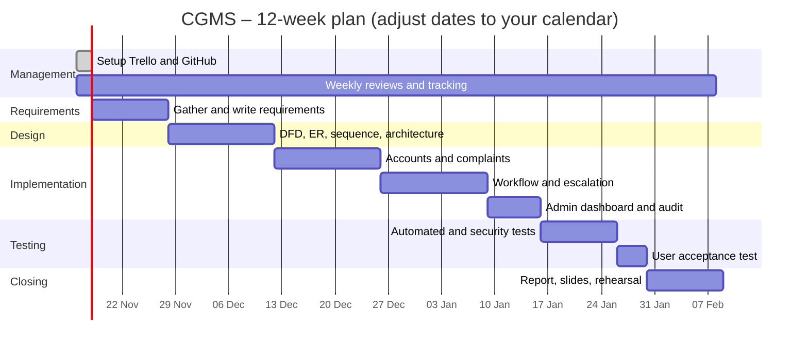

# Project plan

## 1. Work Breakdown Structure
```
1 CGMS project
├── 1.1 Project management
│   ├── 1.1.1 Create Trello board and GitHub repository
│   ├── 1.1.2 Assign roles and weekly meetings
│   └── 1.1.3 Risk register and progress tracking
├── 1.2 Requirements
│   ├── 1.2.1 Gather requirements (survey / interviews)
│   ├── 1.2.2 Write functional and non-functional requirements
│   └── 1.2.3 Review and sign off
├── 1.3 Design
│   ├── 1.3.1 DFD levels 0, 1, 2 and data dictionary
│   ├── 1.3.2 ER diagram and database schema
│   ├── 1.3.3 Sequence, state and use case diagrams
│   ├── 1.3.4 Architecture and deployment design
│   └── 1.3.5 UI wireframes
├── 1.4 Implementation
│   ├── 1.4.1 Accounts and access control
│   ├── 1.4.2 Complaint submission and routing
│   ├── 1.4.3 Workflow, replies and notifications
│   ├── 1.4.4 Escalation engine
│   └── 1.4.5 Admin dashboard, audit log and export
├── 1.5 Testing
│   ├── 1.5.1 Automated tests
│   ├── 1.5.2 Security review (OWASP checklist)
│   └── 1.5.3 User acceptance test
├── 1.6 Deployment
│   └── 1.6.1 Run guide, demo data and backup plan
└── 1.7 Documentation and presentation
    ├── 1.7.1 Final report
    ├── 1.7.2 Ethics section
    └── 1.7.3 Slides and demo rehearsal
```

## 2. Task table
Replace `[Member]` with real names. Durations are in days.

| ID | Task | Owner | Days | Depends on | Deliverable | Status |
|---|---|---|---|---|---|---|
| T1 | Trello + GitHub setup | [Member 1] | 1 | – | Board, repository | Done |
| T2 | Requirements gathering | [Member 2] | 4 | T1 | Survey results | |
| T3 | Write requirements | [Member 2] | 3 | T2 | REQUIREMENTS.md | |
| T4 | DFD 0/1/2 + data dictionary | [Member 3] | 5 | T3 | DFD.md | |
| T5 | ER diagram + schema | [Member 4] | 3 | T3 | schema.sql | |
| T6 | Sequence/state/use case | [Member 3] | 3 | T3 | SEQUENCE.md | |
| T7 | Architecture + deployment | [Member 1] | 3 | T3 | ARCHITECTURE.md | |
| T8 | Accounts and access control | [Member 4] | 4 | T5 | auth module | |
| T9 | Complaint submission + routing | [Member 2] | 5 | T8 | complaints module | |
| T10 | Workflow + notifications | [Member 3] | 5 | T9 | services module | |
| T11 | Escalation engine | [Member 1] | 3 | T10 | escalation module | |
| T12 | Admin dashboard + audit | [Member 4] | 4 | T10 | admin module | |
| T13 | Automated tests | [Member 2] | 4 | T11, T12 | tests/ | |
| T14 | Security + ethics review | [Member 3] | 3 | T13 | ETHICS.md | |
| T15 | User acceptance test | [Member 1] | 2 | T13 | UAT notes | |
| T16 | Report + slides | All | 5 | T14, T15 | REPORT.md, slides | |

## 3. Milestones
| Milestone | Week |
|---|---|
| M1 Requirements approved | 2 |
| M2 Design complete | 4 |
| M3 Core features working (submit, route, resolve) | 7 |
| M4 Feature complete (escalation, admin) | 9 |
| M5 Testing complete | 10 |
| M6 Final submission and presentation | 12 |

## 4. Schedule


## 5. Effort estimate
| Activity | Person-days | Basis |
|---|---|---|
| Requirements | 7 | Experience from similar coursework |
| Design | 14 | 6 diagrams plus schema |
| Implementation | 21 | About 9 modules and 20 pages |
| Testing | 9 | 17 automated tests plus manual passes |
| Documentation and presentation | 8 | Report, ethics, slides |
| Management | 6 | Meetings, tracking |
| **Total** | **65** | About 16 person-days per member for a team of four |

## 6. Risk register
| # | Risk | Prob. | Impact | Mitigation | Owner |
|---|---|---|---|---|---|
| R1 | A member is unavailable or leaves | Medium | High | Pair on every module, shared repository, documented code | [Member 1] |
| R2 | Requirements misunderstood | Medium | High | Review requirements with sample users before design | [Member 2] |
| R3 | Time overrun near deadline | High | High | Weekly milestones, cut optional features first | [Member 1] |
| R4 | Security flaw (access control, injection) | Medium | High | OWASP checklist, automated authorisation tests, code review | [Member 3] |
| R5 | Data loss (database file) | Low | High | Daily copy of `instance/cgms.db`, Git for code | [Member 4] |
| R6 | Merge conflicts in GitHub | Medium | Medium | Feature branches, small commits, pull-request review | [Member 4] |
| R7 | Library version incompatibility | Medium | Medium | Pin versions that were tested, keep a virtual environment | [Member 3] |
| R8 | Privacy breach of anonymous complaints | Low | High | Central `complainant_label` function, tests, audit log | [Member 2] |
| R9 | SQLite cannot handle many users | Low | Medium | Document the migration path to PostgreSQL | [Member 1] |
| R10 | Demo fails on presentation day | Medium | High | Seed script, rehearsed demo script, screenshots as backup | All |
